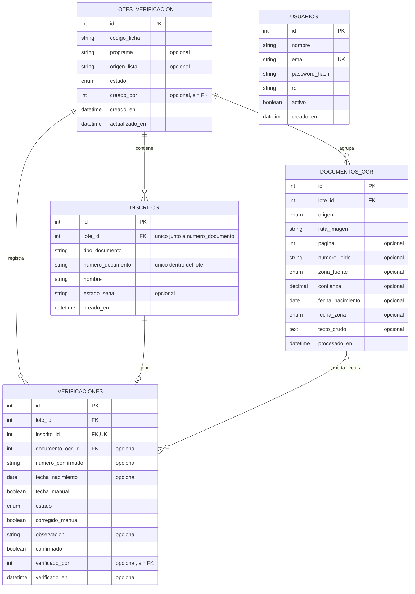
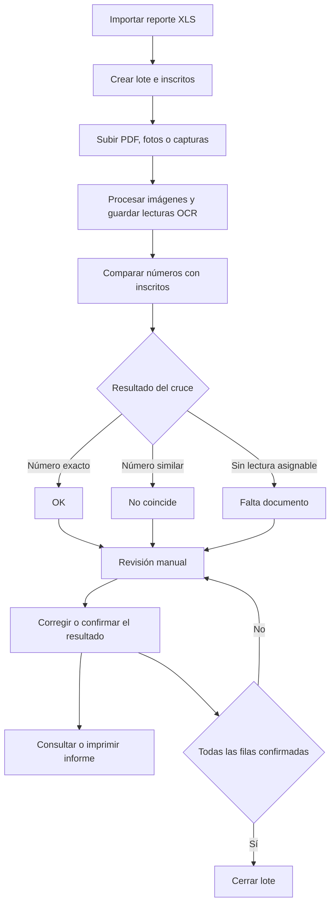

# Modelo lógico del sistema VerificaOCR

Modelo relacional basado en `sql/schema.sql`. Describe el esquema del proyecto; no representa una inspección del esquema desplegado. El sistema importa inscritos por lote, procesa imágenes y relaciona las lecturas con inscritos mediante verificaciones.

## Diagrama de entidades y relaciones

PK: clave primaria. FK: clave foránea. UK: restricción única. Los números de identificación se guardan como texto, no como cantidades numéricas.

## Entidades

| Entidad | Responsabilidad |
|---|---|
| Lotes de verificación | Agrupar una importación: ficha, programa, archivo de origen y estado. |
| Inscritos | Guardar las personas del reporte importado y su identificación. Una persona puede aparecer en diferentes lotes como registros independientes. |
| Documentos OCR | Registrar una imagen procesada, su origen y la información extraída. La imagen está en el disco; la base guarda su ruta. |
| Verificaciones | Vincular un inscrito con una lectura opcional y guardar el resultado de la revisión manual. |
| Usuarios | Conservar la estructura histórica de operadores. El acceso actual no requiere login y las nuevas importaciones y confirmaciones guardan el operador como NULL. |

## Cardinalidades y restricciones

| Relación | Cardinalidad actual | Regla |
|---|---|---|
| Lote → Inscritos | 1 a 0..N | Cada inscrito pertenece a un lote obligatorio. |
| Lote → Documentos OCR | 1 a 0..N | Cada documento pertenece a un lote obligatorio. |
| Lote → Verificaciones | 1 a 0..N | Cada verificación pertenece a un lote obligatorio. |
| Inscrito → Verificación | 1 a 0..1 | `inscrito_id` es único; antes del cruce puede no existir verificación. |
| Documento OCR → Verificaciones | 1 a 0..N | El esquema permite reutilizar una lectura en varias verificaciones. Cada verificación admite cero o un documento. |

- `usuarios.email` es único.
- La combinación `(inscritos.lote_id, inscritos.numero_documento)` es única; no incluye el tipo de documento.
- `codigo_ficha` tiene índice, pero no es único: pueden existir varios lotes para la misma ficha.
- `creado_por` y `verificado_por` no tienen FK a usuarios en el esquema. Son referencias históricas previstas, no relaciones garantizadas por la base.
- Eliminar un lote elimina sus inscritos, lecturas OCR y verificaciones por cascada.
- Eliminar un inscrito elimina su verificación por cascada.
- Eliminar un documento OCR deja `documento_ocr_id` en NULL en las verificaciones relacionadas; no recalcula su estado.
- Eliminar registros de la base no elimina automáticamente las imágenes del disco.

## Dominios de estado

| Campo | Valores permitidos |
|---|---|
| Lote.estado | `en_proceso`, `verificado`, `cerrado` |
| Documento.origen | `pdf`, `foto`, `camara` |
| Documento.zona_fuente | `mrz`, `codigo_barras`, `frontal`, `desconocida`, NULL |
| Documento.fecha_zona | `mrz`, `frontal`, NULL |
| Verificación.estado | `ok`, `corregido`, `no_coincide`, `falta_documento` |

`confirmado` es independiente del estado: una fila puede estar confirmada como faltante o como no coincidente. El estado `verificado` del lote existe en el esquema, aunque el flujo actual utiliza principalmente `en_proceso` y `cerrado`.

## Proceso lógico

Un faltante significa que el cruce no encontró una lectura asignable; no demuestra por sí solo que la persona no haya entregado el documento. El informe se puede consultar antes del cierre y se calcula a partir de las verificaciones: no existe una tabla de informes.

## Reglas deseadas que el esquema no garantiza

Estas son mejoras propuestas, no características ya implementadas:

1. Asegurar que el inscrito y el documento vinculados a una verificación pertenezcan al mismo lote que ella. Las FK individuales actuales no verifican esa coherencia.
2. Si cada lectura debe justificar solo un inscrito, imponer unicidad de `documento_ocr_id` cuando no sea NULL y reservar primero los documentos con coincidencia exacta.
3. Recalcular el estado en el servidor al confirmar, sin depender del estado enviado por el navegador.
4. Conservar el número corregido al guardar una edición pendiente, sin exigir confirmación para persistir esa edición.
5. Separar explícitamente los documentos no entregados de las imágenes entregadas cuya lectura falló.

El modelo actual conserva `lote_id` en verificaciones aunque se puede obtener desde el inscrito. Esa redundancia facilita consultas, pero requiere controles para evitar relaciones entre lotes distintos.
